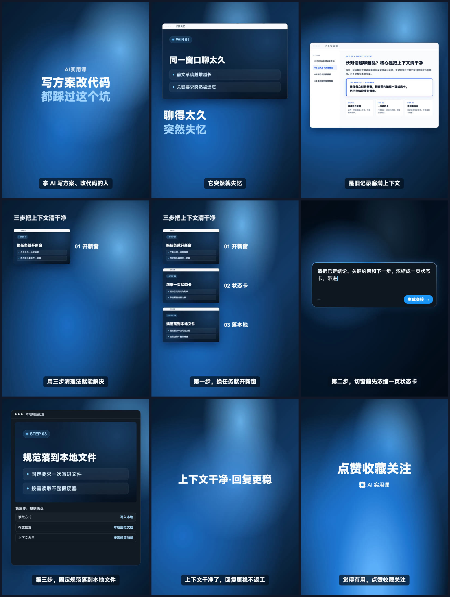
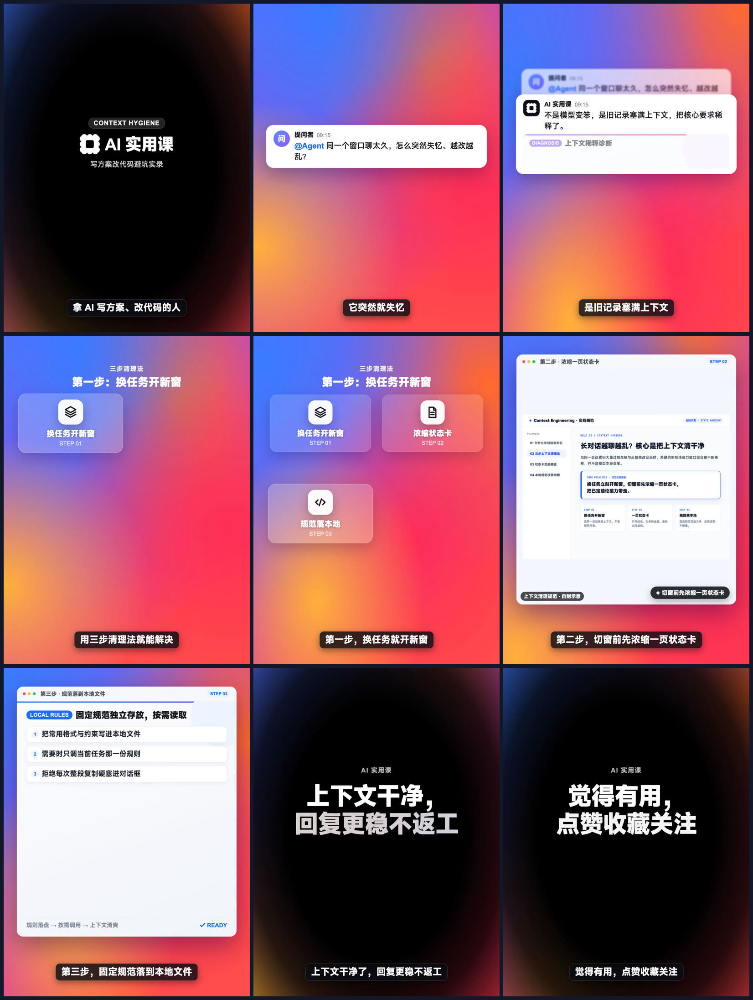
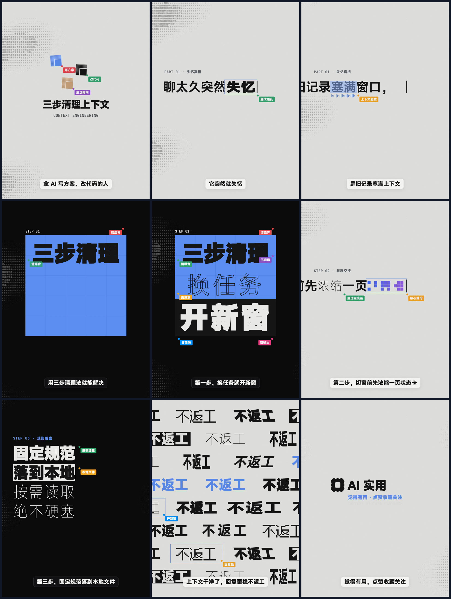
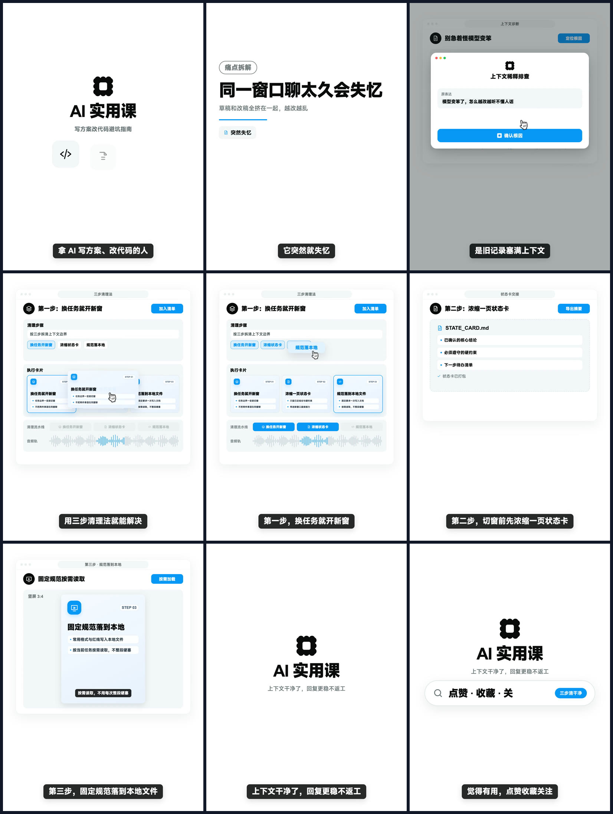

# neil-video

> 原 `talk-workbench` v2.0 全面升级更名版：一套**配音驱动的五风格口播讲解视频工作流 + AI Skill**（基于 Remotion）。

输入一条确认好的口播配音，即可在 **5 套模块化视觉风格** 间自由切换，原生输出 **3:4 竖屏主标准（`1080×1440`）** 与 **16:9 横屏（`1920×1080`）**（保留 `9:16` 兼容），全系遵循**三脚架零晃动铁律**，零 `.mp4` 录屏即可用内置 UI 卡片或纯排印直接成片，自动完成轻音效合成与 `-14.5 LUFS` 广播级响度收尾。

---

## v2.0 核心升级（2026-11-19）

- **五套配音驱动模块化风格全打通**：
  1. **简约工作台**（`Hybrid3x4` / `HybridLandscape` / `Story3x4`）：概念碎片 + 示意工作台 + 真实页面聚光抬卡（`30fps`）。
  2. **蓝光口播版**（`BlueTalk3x4` / `BlueTalk`）：深海蓝光底场、特写卡、提示词输入与编辑器面板（`60fps`）。
  3. **虹彩对话版**（`PrismTalk3x4` / `PrismTalk`）：虹彩流体底场、顶边锁死景深问答气泡与无缝预览窗（`60fps`）。
  4. **纸感排印版**（`PaperTalk3x4` / `PaperTalk`）：浅灰纸底 + ASCII 点阵 + 6 种词形变形 + 字墙与黑底海报，纯文字零素材出片（`60fps`）。
  5. **纯白镜头版**（`CleanTalk3x4` / `CleanTalk`）：纯白界面、手形光标拖拽/点击、弹窗前后润色、看板拾取与横竖预览（`60fps`）。
- **竖屏主标准切换为 `3:4`（`1080×1440`）**：主体内容集中在 `[48..1032]×[60..1230]` 安全区，独立字幕栏固定在 `y ≈ 1292`，解决瘦长 `9:16` 上下空旷与移动端信息流底部文案遮挡问题；横屏保持 `16:9`（`1920×1080`）。
- **全画幅三脚架零晃动铁律**：统一采用单调无过冲缓出曲线，入场落定后 100% 静止锁死；彻底移除 `Math.sin` 浮动、弹簧回弹与线性微爬缩放；重点强调仅做干脆单向定点推近并稳停。
- **开箱零 `.mp4` + 跨平台字体 + 去私有品牌化**：内置 `MiSans VF`、`JetBrains Mono` 与 `Workbench Pixel CN`，全部示例均不依赖外部 `.mp4` 录屏或 macOS 专属字体；`from_audio.py` 生成的起始配置 100% 读取用户自定义 `--brand`。
- **端到端质量保障**：`CleanTalk` 手机预览框静态图默认 `contain` 防横向裁切；`from_audio.py` 优化无标点中文转写断句；全库 107 项自动化单测 + TypeScript 类型检查 + 多画幅配置校验一次全过。

---

## 五套风格 `3:4` 实测画面一览

以下五张九宫格均由同一条 `34.2s` 全新口播配音驱动、零外部录屏素材实渲生成：

| 风格 1 · 简约工作台 (`Hybrid3x4`) | 风格 2 · 蓝光口播 (`BlueTalk3x4`) | 风格 3 · 虹彩对话 (`PrismTalk3x4`) |
| :---: | :---: | :---: |
|  |  |  |

| 风格 4 · 纸感排印 (`PaperTalk3x4`) | 风格 5 · 纯白镜头 (`CleanTalk3x4`) |
| :---: | :---: |
|  |  |

---

## 五套风格选型速查

| 风格 | `--style` | `3:4` 竖屏主入口 | `16:9` 横屏入口 | 帧率 | 适合什么内容 | 规则文档 |
| --- | --- | --- | --- | --- | --- | --- |
| **简约工作台** | `default` | `Hybrid3x4` · `Story3x4` | `HybridLandscape` · `StoryLandscape` | 30fps | 工作流拆解、文档原文聚光、操作步骤 | [hybrid.md](references/hybrid.md) · [story-flow.md](references/story-flow.md) |
| **蓝光口播版** | `blue` | `BlueTalk3x4` | `BlueTalk` | 60fps | 工具盘点、深色科技感展示、提示词演示 | [blue-talk.md](references/blue-talk.md) |
| **虹彩对话版** | `prism` | `PrismTalk3x4` | `PrismTalk` | 60fps | 痛点问答对话、前后诊断、多要点窗口拆解 | [prism-talk.md](references/prism-talk.md) |
| **纸感排印版** | `paper` | `PaperTalk3x4` | `PaperTalk` | 60fps | 观点提炼、方法论金句、零图片纯文字高张力表达 | [paper-talk.md](references/paper-talk.md) |
| **纯白镜头版** | `clean` | `CleanTalk3x4` | `CleanTalk` | 60fps | 清爽产品演示、前后对比润色、结构化清单 | [clean-talk.md](references/clean-talk.md) |

> 另附独立沙盒 `ExpLab` / `ExpLab3x4`（5 套皮肤 × 7 套几何信息结构），详见 [exp-adu-archetypes.md](references/exp-adu-archetypes.md)。历史方案 D 演示成片仍保留在 [assets/demo.mp4](assets/demo.mp4) 与 [assets/demo-contact.jpg](assets/demo-contact.jpg)。

---

## 三步跑起来

环境要求：Node.js 20+、Python 3、FFmpeg。

```bash
git clone https://github.com/Nealsun1993/neil-video.git
cd neil-video/template
npm ci && npm run setup          # 安装依赖并复制内置免费商用字体
python3 -m pip install -r requirements.txt
npm run verify                   # 跑通 107 项单测、类型检查与全期多画幅校验
```

实时预览全部 5 套风格：

```bash
npm run preview                  # 启动 Remotion Studio
```

---

## 做自己的一期视频

所有命令在 `template/` 目录下执行：

### 1. 从配音自动生成起片配置

```bash
python3 scripts/from_audio.py 你的配音.wav my-episode \
  --style clean \
  --format 3:4 \
  --brand "你的频道名" \
  --title "本期标题"
```

- `--style` 可选 `blue`、`prism`、`paper`、`clean`、`default`；
- 四套 `*Talk` 风格生成的 `public/episodes/my-episode/episode.json` 默认使用零外部 `.mp4` 的内置 UI 卡片，开箱即通过多画幅校验；
- 通读 `captions` 修正同音错字，按对应风格文档微调场景文案与关键词时间 `at`。

### 2. 生成轻音效、校验并导出成片

```bash
# 生成贴合镜头切点与动作拍点的轻音效轨
python3 scripts/talk-sfx.py my-episode

# 校验配置与类型
npm run verify

# 导出 3:4 主标准竖屏（横屏改为 CleanTalk --props='{"episode":"my-episode","format":"landscape"}'）
npm run export -- CleanTalk3x4 --props='{"episode":"my-episode","format":"3:4"}'

# 响度收尾至 -14.5 LUFS / True Peak <= -1 dBTP（视频流无损复制）
python3 scripts/talk-finish.py exports/<刚导出的文件名>.mp4 exports/my-episode-final.mp4

# 全帧解码校验（无输出即通过）
ffmpeg -v error -i exports/my-episode-final.mp4 -f null -
```

---

## 作为 AI Skill 使用

把本仓库克隆到你的 Agent Skill 目录即可：

```bash
git clone https://github.com/Nealsun1993/neil-video.git ~/.claude/skills/neil-video
```

本地 Codex 用户也可在 `template/` 下运行 `npm run skill:install` 自动安装本地路径入口。之后直接对 Agent 说：「用 `neil-video` 的纯白镜头风格把这条配音做成 3:4 讲解视频」，并提供配音文件与确认过的文稿即可。

---

## 目录结构

```text
neil-video/
├─ SKILL.md                  Agent 执行入口与全部硬规则
├─ 视频规则.md                五套主推风格与统一动效规范
├─ LOCAL_STATUS.md           验证基线与迭代记录
├─ references/               五套风格细则、ExpLab 实验文档与验收清单
├─ assets/                   五套风格 3:4 九宫格样张与历史演示片
└─ template/                 Remotion 工程
   ├─ src/templates/         五套口播引擎（BlueTalk / PrismTalk / PaperTalk / CleanTalk / Scene）与 ExpLab
   ├─ src/app/               简约工作台窗口引擎与页面模板
   ├─ src/kit/               时间轴解析、多画幅几何、三脚架动效、多风格校验器与 UI 皮肤
   ├─ scripts/               from_audio.py / talk-sfx.py / talk-finish.py / check-episodes.ts / local-workbench.cjs
   ├─ tests/                 107 项自动化单元与边界测试
   └─ public/episodes/       五套开箱即跑的零录屏演示配置
```

---

## 它不做什么

- **不内置商业 TTS 或真人视频语义剪辑**：配音作为输入接入，真人原片修字删词请先由外部剪辑流程导出定稿音频。
- **不含作者私人声纹、头像与未授权素材**：所有品牌名、身份、卡片文案均由当期 `episode.json` 指定。

---

## 授权

本仓库代码和文档以 [MIT](LICENSE) 授权。第三方依赖与字体许可通知见 [THIRD_PARTY_NOTICES.md](THIRD_PARTY_NOTICES.md)：

- **[Remotion](https://www.remotion.dev/)**：个人和小团队免费，商业/公司使用请遵守 [remotion.dev/license](https://www.remotion.dev/license)。
- MiSans（小米字体，免费商用，安装时通过 `npm run setup` 复制，不随仓库分发）
- JetBrains Mono（OFL） · Phosphor Icons（MIT） · rough.js（MIT）

示例旁白为作者本人录制/合成的演示音频，仅用于功能展示。

## 作者

尼尔.S。如果这套工作流帮到了你，欢迎在作品简介里提一句 `neil-video`。
